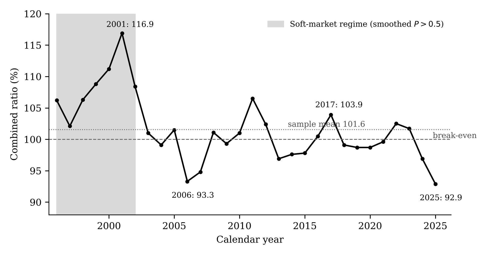

# Underwriting Cycles and the Calibration of Premium Risk under Solvency II

Data and code for every estimate, table and figure of

> Aslan, I. (2026). Underwriting cycles and the calibration of premium risk under Solvency II. Working paper. [SSRN 7127360](https://ssrn.com/abstract=7127360)



The Solvency II standard formula computes the capital requirement for non-life premium risk as a fixed multiple of a time-invariant volatility factor and a premium-based volume measure. Neither conditions on the underwriting cycle, a limitation the 2011 calibration working group recorded and deferred. Because premium is price times exposure, the volume measure lowers required capital per unit of exposure exactly when falling prices raise the expected loss ratio of the incoming business. The paper gives the problem a formal representation, quantifies it and proposes an implementation within the existing architecture.

## Main results

A two-regime Markov-switching model of the US calendar-year combined ratio, 1996–2025, identifies a soft-market regime (mean 108.4, s.d. 4.4) against a hard/moderate regime (mean 99.4, s.d. 3.2), with staying probabilities of 0.94 and 0.97. Capital at the 99.5 per cent standard, per 100 of premium (Table 1):

| State | Unexpected-loss basis | Break-even basis |
|---|---|---|
| Unconditional (static calibration) | 13.6 | 15.1 |
| Hard/moderate regime | 8.2 | 8.2 |
| Soft regime | 11.4 | 19.8 |

Under state-conditioned best estimates the static charge over-provides in both regimes while allocating capital inversely to conditional risk. Under break-even anchoring it covers only 76.5 per cent of the soft-state requirement. The same regime gap of about nine points appears in accident-year ratios and in the Lloyd's attritional ratio, 2008–2025.

## Files

| File | Content |
|---|---|
| `replicate.py` | Every estimate: capital comparison and variance decomposition (Table 1); AR(2), constrained Markov-switching estimates, profile-likelihood region and model comparison (Table 2); bootstrap intervals (Table 3); accident-year and Lloyd's estimates (Table 4, Figure 3); reinsurance decomposition (Table 5); simulated coverage study (Table 6); capital-neutral calibration of the loading and level diagnostic (Table 7); real-time checks of the price-index rule and of the regime model (Table 8, Figure S1); distributional sensitivity (Table A1); Figures 1 to 3 |
| `data.csv` | Combined ratios and price series with a source key per observation (see Data) |
| `results/output.txt` | Console output of the full run |
| `results/backtest.csv`, `realtime_price_index.csv` | Real-time checks (Table 8) |
| `results/fig1_regimes.png`, `fig2_ay_cy.png`, `fig3_lloyds.png`, `figS1_price_index.png` | Figures 1 to 3 and S1 |

## Data

- `cr_cy`: calendar-year net combined ratio, US property-casualty industry, 1996–2025. 1996–2014: Insurance Information Institute presentation of NAIC data sourced from S&P Global Market Intelligence (Lynch 2016, exhibit "AY vs. CY Combined Ratio"). 2015–2025: NAIC, *U.S. Property & Casualty and Title Insurance Industries – Full Year Results*, ten-year tables of the 2024 and 2025 reports.
- `cr_ay`: accident-year combined ratio excluding guaranty lines, 1996–2015, evaluated as of 2015 (same exhibit; the 2015 figure is marked preliminary in the source).
- `lloyds_cr_cy`: Lloyd's market calendar-year combined ratio, 2002–2025, from the five-year tables of the annual reports.
- `lloyds_ay_exmajor`, `lloyds_major_claims`, `lloyds_prior_year`: Lloyd's accident-year ratio excluding major claims and the other two contributors to the combined ratio, 2008–2025. For 2023–2025 the first is the attritional loss ratio plus the expense ratio; major claims for 2008–2011 follow from the accounting identity.
- `ppi_pc`: producer price index, direct property and casualty insurers (BLS series PCU524126524126, June 1998 = 100), annual average, 1999–2024.
- `cpi_u`: consumer price index for all urban consumers (BLS series CPIAUCNS), annual average, 1999–2024. Both price series were retrieved from FRED on 12 November 2026.

## Estimation

The likelihood of a Gaussian Markov-switching model with regime-dependent variances is unbounded (Kiefer 1978). The estimates are the maximum under Hathaway's (1985) constraint on the ratio of regime standard deviations (at most ten), obtained by EM from forty starting values followed by direct maximisation. The code does not depend on statsmodels.

## Running the code

```
python -m pip install -r requirements.txt
python replicate.py > results/output.txt            # full run, about six minutes
python replicate.py --quick                         # point estimates, model comparison, Tables 1, 2A, 2C, 4, 5, A1 and Figures 1-3, in seconds
```

All random draws use fixed seeds; the full run reproduces `results/` exactly apart from the timing lines. It was last checked with Python 3.13, NumPy 2.5, SciPy 1.18, pandas 3.0 and Matplotlib 3.11.

## Citation

Please cite the paper. GitHub's "Cite this repository" button gives the reference in APA and BibTeX formats.

## Licence

Code: MIT licence (see `LICENSE`). The data are compiled from the public sources listed above.

## Author

Ilker Aslan, Lecturer, Kalaidos University of Applied Sciences, Zürich
[ORCID 0000-0001-9241-9420](https://orcid.org/0000-0001-9241-9420) · [ilkeraslan.github.io](https://ilkeraslan.github.io)
